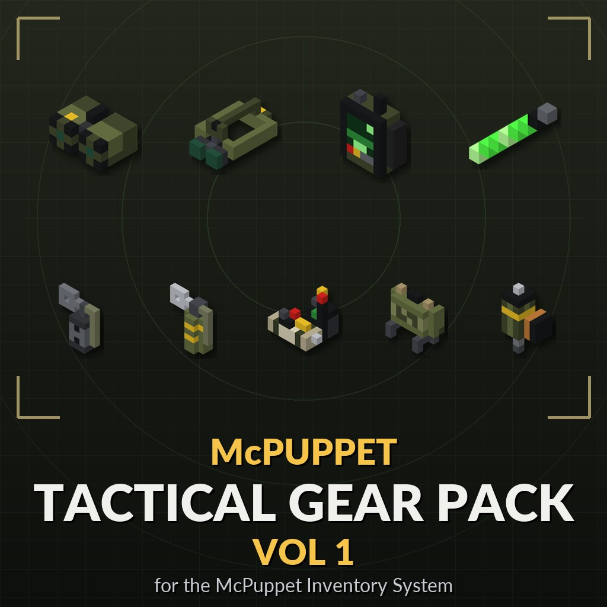

# McPuppet Tactical Gear Pack Vol 1

On the Steam Workshop: [McPuppet Tactical Gear Pack Vol 1](https://steamcommunity.com/sharedfiles/filedetails/?id=3843881225)

**9 pieces of tactical gear for the McPuppet Inventory System, on any map, in single player and multiplayer.** Scout with binoculars, track movement through walls, see in the dark, blind a room, hide behind smoke and set traps that go off under someone else's feet.

## Required
[**McPuppet Inventory System**](https://steamcommunity.com/sharedfiles/filedetails/?id=3840357667) (listed under Required items; Steam asks you to subscribe to it too). Enable both, then play any map. Buy the gear in the inventory's store.

## The gear
- **Binoculars**: hold left click to look through them. A mil-dot reticle and a range finder show how far away the thing in the middle is.
- **Motion Sensor**: while you hold it, it pings every 2.5 seconds. Anyone moving within 30 m shows up on your screen as a glowing figure through walls. Standing still or creeping keeps you hidden.
- **Night-Vision Goggles**: worn on the head. Press **N** to switch them on and the dark turns bright green. A flashbang hits much harder through them.
- **Glowsticks** (5 per pack): left click cracks one and throws it. Each glows green for 3 minutes.
- **Flashbang** (2 per pack): goes off 1.8 s after the throw. Anyone within 15 m who can see it is blinded and their ears ring. It hurts most if they're looking straight at it. No damage.
- **Smoke Grenade** (2 per pack): goes off 1.5 s after the throw. A thick cloud for 25 seconds.
- **C4** (one use): first click sticks it where you aim, or throws it so it sticks where it lands. Second click blows it up.
- **Claymore** (one use): set it down facing where you look. It arms after 2.5 s and fires steel pellets at anyone else who walks into its front.
- **Wire Trap** (one use): click to plant the charge on a wall or post, then click again to hook the wire up to 6 m away. Anyone but you crossing the wire sets it off, and so does anything thrown through it.

Anything set down can be shot, hit or caught in a blast: C4, claymores and wire traps go off, a flashbang or smoke grenade pops (a smoking one bursts), a glowstick breaks.

## Multiplayer
The host enables the inventory and this pack under Global mods; everyone downloads them when joining. The host decides every throw, trap and blast, and everyone sees them.

## More
Armour to go with it: **McPuppet Basic Clothing Pack Vol 1** (the tactical vest and helmet). Melee weapons: **McPuppet Basic Melee Weapons Pack Vol 1**.

## Community

Join the [Discord community](https://discord.gg/gNpRewdkxf) to post bug reports and suggestions.

## Install

Subscribe on the [Steam Workshop](https://steamcommunity.com/sharedfiles/filedetails/?id=3843881225), or clone this repository into
`Documents/Teardown/mods/tactical gear pack vol 1`. Enable it under **Global mods** (in multiplayer the host does).

## Credits

Made by AgeOfAlgorithms and Claude (Anthropic). MIT licence.
